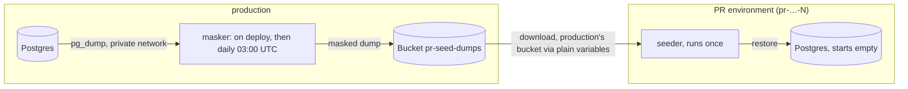

# Architecture

## Components

| Component | Source | Runs | Exits |
|---|---|---|---|
| masker | `Dockerfile`, start `/app/schedule.sh` (runs `/app/mask.sh`) | on deploy, then daily at `MASK_AT_UTC`, restart ON_FAILURE | never in production (a failed run keeps the previous dump); straight away elsewhere |
| seeder | same image, start `/app/seed.sh` | every deploy, restart NEVER | after restore, or straight away when guarded |
| pr-seed-dumps | Railway Bucket | — | — |
| Postgres | Railway Postgres 18 | always | — |

## Masker flow (`scripts/mask.sh`)

1. Exit 0 unless `RAILWAY_ENVIRONMENT_NAME == SOURCE_ENVIRONMENT` (PR environments copy the masker too).
2. `pg_dump --format=plain --no-owner --no-privileges` of `SOURCE_DATABASE_URL`.
3. `initdb` a throwaway Postgres in a temp dir: Unix socket only, no fsync, trust auth.
4. Create database `src`, preload `anon`, `CREATE EXTENSION anon`, `anon.init()` (loads the fake-data and identifier dictionaries).
5. Load the raw dump, then `MASKING_RULES`, both with `ON_ERROR_STOP`.
6. Strict check: `anon.detect('en_US')` direct identifiers in tables with no `anon` security label, minus `ALLOW_UNMASKED`. Any left: exit 1 (or warn with `STRICT=false`).
7. `pg_dump` as role `dump_anon` (`SECURITY LABEL … 'MASKED'`, transparent dynamic masking), with `--clean --if-exists --no-security-labels --exclude-extension=anon`, gzipped.
8. PUT to `<S3_PREFIX|pr-seed>/latest.sql.gz`. The upload is the last step, so a failed run keeps the previous dump.

## Seeder flow (`scripts/seed.sh`)

1. Exit 0 if the environment is `SOURCE_ENVIRONMENT`, or its name doesn't match `SEED_ENVIRONMENT_REGEX` (default `(^|-)pr-([a-z0-9]+-)?[0-9]+$`).
2. Wait up to 120 s for `pg_isready`.
3. Exit 0 if the database comment starts with `pr-seed:` (already seeded).
4. Download the dump. A 404 means the masker has not run yet: exit 1 with that message.
5. `gunzip | psql --single-transaction ON_ERROR_STOP`, plus `COMMENT ON DATABASE … 'pr-seed:<now>'` in the same transaction.

## Railway facts this design depends on (verified 2026-11-10)

- PR environments copy the base environment's services and variables. Sealed variables are not copied.
- Each environment, PR environments included, gets its own bucket with its own name and credentials. A bucket reference resolves to the PR's empty bucket.
- PR environment names: `<project>-pr-<N>`, or `pr-<hash>-<N>` when that name was used recently.
- No runtime variable marks an environment as a PR environment. The API has `Environment.isEphemeral`, but the seeder has no API token.
- Redeploying the masker runs it on demand. The seeder is one-shot with restart NEVER, so it shows as "Completed" whether it exited 0 or 1. Check its logs.
- Template generation (`railway templates create`) keeps references and `secret()` values, but drops literal variable values and the cron schedule.

## Configuration

- `.railway/railway.ts` is the source of truth for services, the bucket, start commands and variables.
- The seeder's `S3_*` values are `preserve()`, set once by `setup/link-seeder.sh` (decisions.md, D3).
- The PR environments toggle is a project setting. IaC cannot express it.
